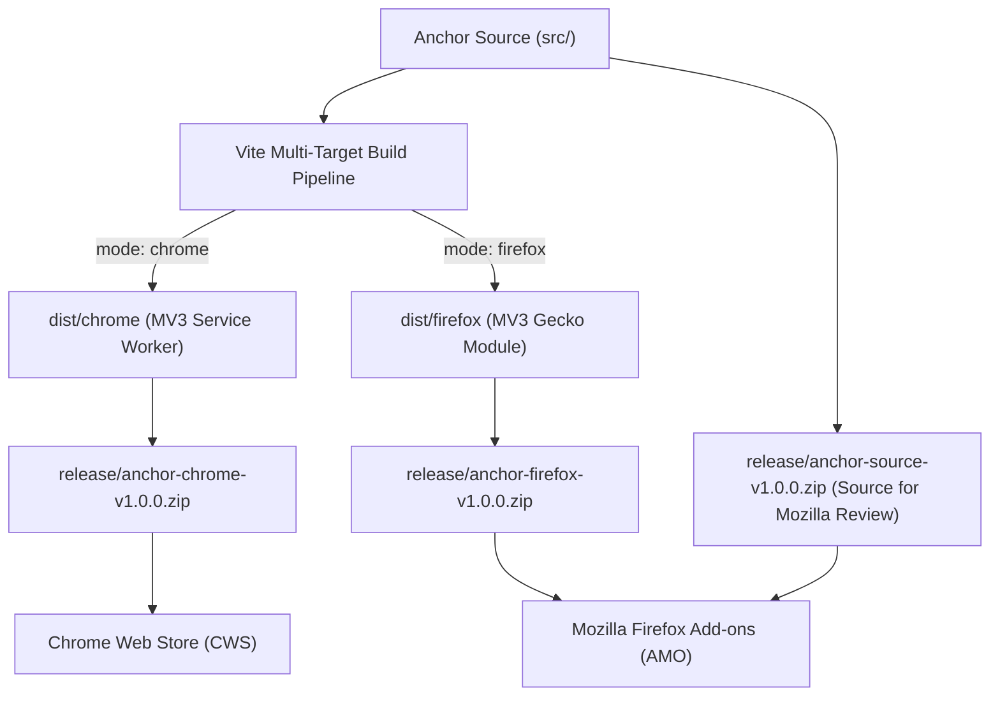

# Anchor: Chrome & Firefox Store Release Guide

> **Official release, publishing, and packaging documentation for Anchor.**  
> Step-by-step instructions for submitting Anchor (WebExtension Manifest V3) to the **Google Chrome Web Store (CWS)** and **Mozilla Firefox Add-ons (AMO)**.

---

## Table of Contents

1. [Architecture & Target Matrix](#1-architecture--target-matrix)
2. [Pre-Release Quality Assurance Checklist](#2-pre-release-quality-assurance-checklist)
3. [Automated Packaging Pipeline](#3-automated-packaging-pipeline)
4. [Google Chrome Web Store (CWS) Publishing](#4-google-chrome-web-store-cws-publishing)
   - [4.1 Prerequisites](#41-prerequisites)
   - [4.2 Uploading the Release Package](#42-uploading-the-release-package)
   - [4.3 Store Listing Details](#43-store-listing-details)
   - [4.4 Graphic Assets Requirements](#44-graphic-assets-requirements)
   - [4.5 Privacy Practices & Permission Justifications](#45-privacy-practices--permission-justifications)
   - [4.6 Review & Publication Timeline](#46-review--publication-timeline)
5. [Mozilla Firefox Add-ons (AMO) Publishing](#5-mozilla-firefox-add-ons-amo-publishing)
   - [5.1 Prerequisites](#51-prerequisites)
   - [5.2 Distribution Options (Listed vs. Unlisted)](#52-distribution-options-listed-vs-unlisted)
   - [5.3 Uploading the Release Package](#53-uploading-the-release-package)
   - [5.4 Source Code Submission (Mandatory for AMO)](#54-source-code-submission-mandatory-for-amo)
   - [5.5 Listing Information & Reviewer Notes](#55-listing-information--reviewer-notes)
   - [5.6 Review & Approval Workflow](#56-review--approval-workflow)
6. [Local Testing & Sideloading](#6-local-testing--sideloading)
7. [Store Review Compliance & Common Pitfalls](#7-store-review-compliance--common-pitfalls)
8. [Maintenance, Version Bumps & Hotfixes](#8-maintenance-version-bumps--hotfixes)

---

## 1. Architecture & Target Matrix

Anchor is engineered as a unified, cross-browser WebExtension built with TypeScript and Vanilla CSS, compiled into two optimized platform bundles via Vite:

| Attribute | Google Chrome (`dist/chrome`) | Mozilla Firefox (`dist/firefox`) |
| :--- | :--- | :--- |
| **Manifest Version** | Manifest V3 (`3`) | Manifest V3 (`3`) |
| **Background Runner** | Service Worker (`"service_worker": "background.js"`) | Background Module (`"scripts": ["background.js"]`) |
| **Extension ID** | Auto-assigned by Chrome Web Store upon upload | Explicit Gecko ID: `anchor@mindful.browsing` |
| **Min Platform Version** | Chrome 102+ | Firefox 109+ (strict_min_version) |
| **Permissions API** | Standard `chrome.*` & `browser.*` via `webextension-polyfill` | Standard `browser.*` & `webextension-polyfill` |
| **Data Storage** | `chrome.storage.local` (100% offline, client-side only) | `chrome.storage.local` (100% offline, client-side only) |
| **Remote Network Calls** | **0** (Zero telemetry, zero remote hosted scripts) | **0** (Zero telemetry, zero remote hosted scripts) |



---

## 2. Pre-Release Quality Assurance Checklist

Before packaging for store submission, execute the complete test suite and manifest verification:

### 2.1 Automated Test Suite & Type Checking

Run all test suites and ensure 100% pass rate:

```bash
# 1. Typecheck the TypeScript codebase
npm run typecheck

# 2. Run Vitest unit & contract tests (36 tests)
npm test

# 3. Verify test coverage
npm run test:coverage
```

### 2.2 Manual Functional Verification Matrix

Conduct a manual verification cycle using the developer sideloading instructions in Section 6:

- [ ] **Breathing Interstitial Pause**:
  - Navigate to a configured mindful domain (e.g. `youtube.com` or `reddit.com`).
  - Verify that the card halts content loading and the soothing breathing circle animates smoothly for 3 seconds.
  - Verify clicking **"Close Tab"** immediately closes the tab without loading the site.
- [ ] **Intention Setting**:
  - Verify selecting a preset pill (*Work/Research*, *Quick Check*, *Boredom/Escapism*) sets intention and reveals the site.
  - Verify custom text intention input submits and sets intention correctly.
- [ ] **In-Session Follow-Up Nudge (Quick Check)**:
  - Configure threshold or test dwell time past 7 minutes on a mindful site.
  - Verify the non-blocking shadow-DOM toast slides into the bottom-right corner without freezing page interaction.
  - Verify clicking **"Keep Going"** dismisses the toast; clicking **"Close Tab"** closes the tab.
- [ ] **5-Second Exit Micro-Reflection**:
  - Close the tab or switch away >15 minutes.
  - Verify the exit notification toast appears (*"How did this session feel?"*).
  - Test selecting **Nourishing** (green), **Neutral** (gray), and **Draining** (red).
  - Verify notification auto-dismisses after 5 seconds if ignored.
- [ ] **Attention Ledger & Weekly Reflection Story**:
  - Open popup dashboard from toolbar icon.
  - Verify Attention Ledger displays logged sessions and sentiments.
  - Verify Weekly Reflection Story card computes time and sentiment percentages without judgmental language.
  - Verify late-night soft cap suggestion toggles correctly.
- [ ] **Settings & Custom Domains**:
  - Add and remove custom domains (e.g. `news.ycombinator.com`).
  - Adjust breathing pause slider (3s–5s) and quick-check threshold (5–15m).
  - Reload extension and verify preferences persist in `chrome.storage.local`.

---

## 3. Automated Packaging Pipeline

Anchor features an automated packaging script in [`scripts/package-extension.js`](file:///Users/omkar/projects/Anchor/scripts/package-extension.js) that compiles both targets, creates root-level store archives, and builds the Mozilla source code submission bundle.

### 3.1 Generate Release Archives

Run the package command from the workspace root:

```bash
npm run package
```

The script performs the following actions:
1. Compiles the Chrome production bundle to `dist/chrome`.
2. Compiles the Firefox production bundle to `dist/firefox`.
3. Verifies both `manifest.json` files for MV3 compliance.
4. Generates store-ready `.zip` archives inside `release/`:
   - `anchor-chrome-v<version>.zip`: Root-level archive of `dist/chrome/`.
   - `anchor-firefox-v<version>.zip`: Root-level archive of `dist/firefox/`.
   - `anchor-source-v<version>.zip`: Clean source code bundle for Mozilla review.
5. Computes SHA256 checksums and writes them to `release/checksums.txt`.

> [!IMPORTANT]
> **Root-Level Archive Compliance**: Browser extension stores require `manifest.json` to be located at the root of the ZIP file, not inside a nested directory (e.g., `dist/chrome/manifest.json`). The automated script packages the contents directly to guarantee store acceptance.

---

## 4. Google Chrome Web Store (CWS) Publishing

### 4.1 Prerequisites

1. **Google Account with 2-Step Verification**: Mandatory for all Chrome Web Store developers.
2. **Chrome Developer Dashboard Registration**:
   - Visit the [Chrome Developer Dashboard](https://chrome.google.com/webstore/devconsole).
   - Pay the one-time registration fee ($5 USD).
   - Accept the Developer Agreement and Policies.

### 4.2 Uploading the Release Package

1. Sign in to the [Chrome Developer Dashboard](https://chrome.google.com/webstore/devconsole).
2. Click **Add new item** in the top-right corner.
3. Drag and drop `release/anchor-chrome-v1.0.0.zip` or click **Browse files**.
4. The dashboard will automatically validate your `manifest.json`.

### 4.3 Store Listing Details

Fill in the metadata under the **Store Listing** tab (refer to [`docs/STORE_LISTING.md`](file:///Users/omkar/projects/Anchor/docs/STORE_LISTING.md) for ready-to-copy text):

- **Product Name**: `Anchor - Mindful Browsing & Time Audit`
- **Summary** (max 132 chars):  
  `Drop anchor before you drift away. A supportive mindful pause interception and reflective attention ledger for your tabs.`
- **Description**: Copy the detailed description from [`docs/STORE_LISTING.md`](file:///Users/omkar/projects/Anchor/docs/STORE_LISTING.md#detailed-description-chrome-web-store--firefox-amo).
- **Category**: `Productivity` or `Lifestyle`
- **Language**: `English`

### 4.4 Graphic Assets Requirements

Upload the promotional graphics into the **Graphic Assets** section:

| Asset Type | Dimension | Format | Notes |
| :--- | :--- | :--- | :--- |
| **Store Icon** | 128 x 128 px | PNG | Use [`src/assets/icons/icon-128.png`](file:///Users/omkar/projects/Anchor/src/assets/icons/icon-128.png) |
| **Screenshots** (1–5) | 1280 x 800 px or 640 x 400 px | PNG / JPEG | Capture breathing interstitial, intention selection, in-session nudge, exit reflection, and weekly reflection story |
| **Small Promo Tile** | 440 x 280 px | PNG / JPEG | Calm teal-blue background with Anchor logo and tagline |
| **Large Promo Tile** (optional) | 920 x 680 px | PNG / JPEG | For featured placements |
| **Marquee Promo Tile** (optional) | 1400 x 560 px | PNG / JPEG | For hero carousel placements |

### 4.5 Privacy Practices & Permission Justifications

Under the **Privacy Practices** tab, declare the single-purpose and permission rationale:

#### Single Purpose Statement
```text
Anchor serves a single, focused purpose: empowering users to practice mindful digital well-being by pausing impulsive tab navigation, facilitating gentle in-session check-ins, and recording reflective session sentiment in a 100% client-side attention ledger.
```

#### Permission Justifications

Paste these exact justifications into the dashboard for each requested permission:

- **`storage`**:
  > *Used exclusively to store user-configured mindful domains, coaching thresholds, and private session records locally on the user's device via chrome.storage.local.*
- **`tabs`**:
  > *Used to detect when the user initiates navigation to a configured mindful domain so Anchor can display the mindful pause interstitial before the website loads.*
- **`notifications`**:
  > *Used to present the frictionless 5-second exit micro-reflection ("How did this session feel?") when a user closes or concludes a session on a mindful site.*
- **`idle`**:
  > *Used to detect when the user steps away or locks their computer, ensuring inactive time is excluded from active session dwell calculations.*
- **`alarms`**:
  > *Used to schedule in-session gentle realignment check-ins (e.g. at the 7-minute mark) and periodic local rollup computations in the background service worker.*
- **`<all_urls>` (Host Permissions)**:
  > *Required because users can customize and add any website of their choice (e.g., specific news blogs, online forums, shopping sites) to their personal mindful interception list.*

#### Data Usage Declarations
- **Data Collection**: Select **"No"** to all data collection types (Location, Personally Identifiable Information, Health, Financial, Authentication, Personal Communications, User Activity, Website Content).
- **Certification**: Check all compliance checkboxes:
  - [x] *I certify that this extension complies with the Limited Use policy.*
  - [x] *I do not sell or transfer user data to third parties.*
  - [x] *I do not use or transfer user data for purposes unrelated to the item's core functionality.*
  - [x] *I do not use or transfer user data to determine creditworthiness or for lending purposes.*
- **Privacy Policy**: Provide the public URL to your privacy policy (e.g. `https://github.com/omkar/Anchor/blob/main/docs/PRIVACY_POLICY.md`).

### 4.6 Review & Publication Timeline

1. Click **Submit for Review**.
2. **Review Duration**: Chrome Web Store reviews typically take between **24 to 72 hours** for extensions requesting host permissions (`<all_urls>`).
3. **Automated Publishing**: Select whether to publish immediately upon approval or stage publication manually.

---

## 5. Mozilla Firefox Add-ons (AMO) Publishing

### 5.1 Prerequisites

1. **Firefox Account**: Register at [addons.mozilla.org](https://addons.mozilla.org/).
2. **Two-Factor Authentication (2FA)**: Mandatory for all AMO developer accounts.
3. Access the [AMO Developer Hub](https://addons.mozilla.org/developers/).

### 5.2 Distribution Options (Listed vs. Unlisted)

When submitting an add-on, Mozilla provides two distribution channels:

1. **On this site (Listed)** *(Recommended)*:
   - Your extension is published in the public Firefox Add-ons gallery (`addons.mozilla.org`).
   - Automatically updated when you upload new versions.
   - Requires full review by Mozilla human reviewers.
2. **On your own (Unlisted)**:
   - Mozilla signs the extension and generates a signed `.xpi` file.
   - You distribute the `.xpi` file directly via GitHub Releases or your own website.
   - Review is automated and near-instant.

### 5.3 Uploading the Release Package

1. In the AMO Developer Hub, click **Submit a New Add-on** (or **Submit a New Version** for updates).
2. Choose your distribution channel (**On this site**).
3. Upload `release/anchor-firefox-v1.0.0.zip`.
4. The AMO validation linter will scan the bundle. Verify that:
   - `manifest_version: 3` is recognized.
   - `browser_specific_settings.gecko.id: "anchor@mindful.browsing"` is verified.
   - No fatal validation errors are reported.

### 5.4 Source Code Submission (Mandatory for AMO)

> [!WARNING]
> **Mozilla Policy on Bundled / Minified Code**:  
> Mozilla Add-on Policies mandate that any extension containing transpiled, concatenated, or minified code (such as TypeScript compiled via Vite) **MUST** provide the exact original source code and build instructions so reviewers can independently reproduce the binary. **Failure to do this will result in immediate rejection.**

When prompted by the AMO submission form:
> *"Does your add-on use source code that is transpiled, concatenated, minified, or obfuscated?"*

1. Select **Yes**.
2. Upload the source archive generated by the packaging script:  
   `release/anchor-source-v1.0.0.zip`
3. In the **Build Instructions** text area, paste the following reproduction steps:

```markdown
### Build Instructions for Mozilla Reviewers

This extension is built from TypeScript using Vite. To reproduce the exact binary:

1. Environment Requirements:
   - Node.js >= 18.0.0
   - npm >= 9.0.0

2. Steps to build:
   - Unpack the source zip file into an empty directory:
     unzip anchor-source-v1.0.0.zip -d anchor-source/
     cd anchor-source/
   - Install dependencies:
     npm install
   - Compile the Firefox extension:
     npm run build:firefox

3. Verification:
   The compiled output will be generated in `dist/firefox/`.
   The contents of `dist/firefox/` are identical to the submitted `anchor-firefox-v1.0.0.zip`.
```

### 5.5 Listing Information & Reviewer Notes

1. **Summary** (max 250 characters):  
   `A supportive digital well-being extension combining mindful pause interception with a reflective attention ledger. 100% offline and private.`
2. **Categories**: Select **Tabs** and **Privacy & Security** (or **Lifestyle**).
3. **Screenshots & Icon**: Upload `icon-128.png` and promotional screenshots.
4. **Information for Reviewers**: Paste the reviewer notes from [`docs/STORE_LISTING.md`](file:///Users/omkar/projects/Anchor/docs/STORE_LISTING.md#reviewer-notes-firefox-amo--cws).

### 5.6 Review & Approval Workflow

- **Linter Pass**: Automated checks run immediately upon upload.
- **Human Review**: A Mozilla staff or volunteer editor will review the code and test the extension.
- **Approval Time**: Typically **12 to 48 hours**. You will receive an email confirmation once Anchor is signed and live on AMO.

---

## 6. Local Testing & Sideloading

Developers and QA testers can test the production builds before or during store submission:

### 6.1 Google Chrome / Chromium Browsers (Brave, Edge, Opera)

1. Open Chrome and enter `chrome://extensions/` in the URL bar.
2. Enable **Developer mode** toggle in the upper-right corner.
3. Click the **Load unpacked** button.
4. Select the directory:  
   [`/Users/omkar/projects/Anchor/dist/chrome`](file:///Users/omkar/projects/Anchor/dist/chrome)
5. Pin Anchor to your toolbar and verify the icon appears.

### 6.2 Mozilla Firefox

1. Open Firefox and enter `about:debugging#/runtime/this-firefox` in the address bar.
2. Click **Load Temporary Add-on...**.
3. In the file picker, select:  
   [`/Users/omkar/projects/Anchor/dist/firefox/manifest.json`](file:///Users/omkar/projects/Anchor/dist/firefox/manifest.json)
4. Verify the extension loads with ID `anchor@mindful.browsing`.
5. Note: Temporary add-ons remain active until Firefox is restarted.

---

## 7. Store Review Compliance & Common Pitfalls

Review teams at Google and Mozilla enforce strict policies. Here is how Anchor satisfies each critical standard:

| Store Policy | Requirement | How Anchor Complies |
| :--- | :--- | :--- |
| **No Remote Code Execution** | No `eval()`, no external script tags, no loading CDN scripts at runtime. | All JavaScript and CSS are strictly bundled locally in `dist/`. CSP in MV3 enforces local-only execution. |
| **Single-Purpose Policy** | Extension must have a single clear purpose. | Focused entirely on digital well-being via mindful pause and reflective time awareness. |
| **Broad Host Permissions** | Must justify `<all_urls>` permission. | Required because the user specifies custom domains (e.g., forums, blogs, shopping sites) to intercept. |
| **User Privacy & Telemetry** | Clear disclosures of collected data. | Anchor collects **zero telemetry**. 100% of data is stored in `chrome.storage.local`. Zero network traffic. |
| **Manifest Structure** | `manifest.json` at root of ZIP. | Automated packaging script guarantees root-level manifest packaging. |
| **Reproducible Builds (Mozilla)** | Source code must accompany bundled code. | Automated `anchor-source-vX.X.X.zip` and verified build instructions are provided. |

---

## 8. Maintenance, Version Bumps & Hotfixes

When releasing a patch (`1.0.1`), feature update (`1.1.0`), or major release (`2.0.0`):

### Step 1: Update Version Identifiers
Update the version string in all three configuration files:
1. `package.json`: `"version": "1.0.1"`
2. `src/manifest.chrome.json`: `"version": "1.0.1"`
3. `src/manifest.firefox.json`: `"version": "1.0.1"`

### Step 2: Build & Package Release
```bash
# Run tests
npm test

# Build and package both targets
npm run package
```

### Step 3: Git Tag & Commit
```bash
git add package.json src/manifest.chrome.json src/manifest.firefox.json
git commit -m "chore(release): bump version to 1.0.1"
git tag -a v1.0.1 -m "Release v1.0.1"
git push origin main --tags
```

### Step 4: Upload to Stores
1. **Chrome Developer Dashboard**: Click into Anchor -> **Upload updated package** -> upload `release/anchor-chrome-v1.0.1.zip` -> **Submit for review**.
2. **AMO Developer Hub**: Click into Anchor -> **Submit a New Version** -> upload `release/anchor-firefox-v1.0.1.zip` and `release/anchor-source-v1.0.1.zip` -> Submit.
